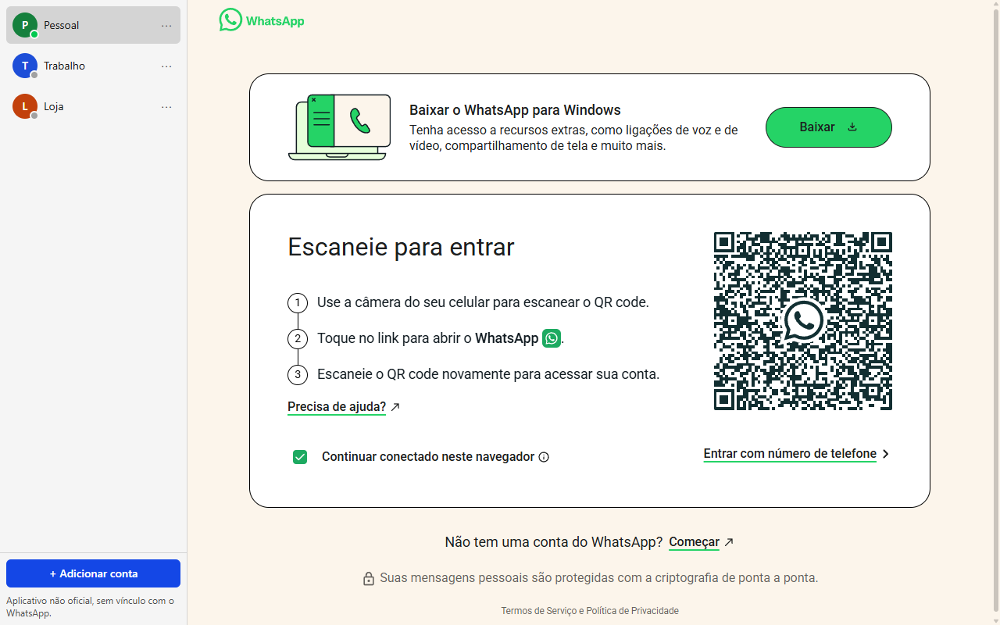

# WhatsApp Multi

[English](#english) · [Português (Brasil)](#português-brasil)



> **Unofficial app.** Not affiliated with, endorsed by or sponsored by WhatsApp or Meta. It only loads the official WhatsApp Web (`web.whatsapp.com`).
> **Aplicativo não oficial.** Sem vínculo, endosso ou patrocínio do WhatsApp ou da Meta. Ele apenas carrega o WhatsApp Web oficial (`web.whatsapp.com`).

---

## English

Desktop app (Windows) to use several WhatsApp accounts side by side, one at a time, each in its own isolated session.

### Features
- Multiple accounts in a sidebar (name, color, unread badge, status indicator).
- Only one account is displayed at a time; switch by click, `Ctrl+1..9` or `Ctrl+Tab` / `Ctrl+Shift+Tab`.
- Add, rename, recolor, reorder and remove accounts (removal clears that account's session data).
- Login with WhatsApp's own QR code (Phone → *Linked devices* → *Link a device*).
- Each account runs in an isolated persistent session (`persist:account-<uuid>`); logins survive restarts.
- Inactive accounts are unloaded after 5 minutes to save memory, unless *Keep alive* is enabled.
- Per-account notification toggle; camera/microphone always asks first.
- Light/dark theme (follows the system), English and Brazilian Portuguese.

### How it works and what it does **not** do
The app embeds the official WhatsApp Web, like a browser tab. It does **not** use unofficial protocol libraries, inject scripts, automate messages, scrape pages or read/export session data. See [docs/FEASIBILITY.md](docs/FEASIBILITY.md) and [docs/ARCHITECTURE.md](docs/ARCHITECTURE.md).

**Risk:** WhatsApp does not officially endorse third-party wrappers and may change its web client at any time. The ban risk is considered low because the official client is used unchanged and without automation, but it cannot be guaranteed to be zero. Consider testing with a secondary number first.

### Security
- `contextIsolation`, `sandbox`, no Node in renderers, strict CSP, app served via a private `app://` protocol.
- Typed IPC validated with zod on both request and response, sender frame verified.
- WhatsApp views have no preload; navigation restricted to `whatsapp.com` / `whatsapp.net`; permissions granted only to `https://web.whatsapp.com`.
- Electron fuses enabled (no `RunAsNode`, cookie encryption, ASAR integrity, etc.).
- `accounts.json` stores metadata only (name, color, order, flags), with atomic writes and protection against accidental session wipes.

### Development
Requirements: Node.js 20+ (tested with 24) and npm.

```bash
npm install
npm run dev        # start in development
npm run typecheck
npm run lint
npm test           # unit tests (Vitest)
npm run build
npm run test:e2e   # Electron smoke + account flow (built app, never logs into WhatsApp)
```

Stack: Electron, electron-vite, React 18, TypeScript (strict), Tailwind CSS, i18next, zod, Vitest, Playwright.

### Status
| Phase | Status |
|---|---|
| 1. Feasibility study | ✅ |
| 2. Foundation and security baseline | ✅ |
| 3. Interface | ✅ |
| 4. Accounts and sessions | ✅ |
| 5. Quality (extra tests, performance) | ⏳ |
| 6. Distribution (.exe installer, portable ZIP, CI, releases) | ⏳ |

No installer is published yet. See [ROADMAP.md](ROADMAP.md).

### Known limitations
- Clicking a notification doesn't switch to its account yet.
- The taskbar unread indicator is a simple dot without a number.
- Idle unloading and crash recovery are not covered by automated tests.

---

## Português (Brasil)

Aplicativo desktop (Windows) para usar várias contas do WhatsApp, uma por vez, cada uma em sua própria sessão isolada.

### Funcionalidades
- Várias contas numa barra lateral (nome, cor, contador de não lidas, indicador de estado).
- Apenas uma conta é exibida por vez; troque com clique, `Ctrl+1..9` ou `Ctrl+Tab` / `Ctrl+Shift+Tab`.
- Adicionar, renomear, mudar cor, reordenar e remover contas (remover apaga os dados de sessão daquela conta).
- Login pelo QR code do próprio WhatsApp (Celular → *Aparelhos conectados* → *Conectar um aparelho*).
- Cada conta roda numa sessão persistente isolada (`persist:account-<uuid>`); o login continua após reiniciar.
- Contas inativas são descarregadas após 5 minutos para economizar memória, salvo se *Manter ativa* estiver ligado.
- Notificações configuráveis por conta; câmera/microfone sempre pedem confirmação.
- Tema claro/escuro (segue o sistema), inglês e português do Brasil.

### Como funciona e o que **não** faz
O app incorpora o WhatsApp Web oficial, como uma aba do navegador. Ele **não** usa bibliotecas não oficiais do protocolo, não injeta scripts, não automatiza mensagens, não raspa páginas e não lê nem exporta dados de sessão. Veja [docs/FEASIBILITY.md](docs/FEASIBILITY.md) e [docs/ARCHITECTURE.md](docs/ARCHITECTURE.md).

**Risco:** o WhatsApp não endossa oficialmente apps de terceiros e pode mudar o cliente web a qualquer momento. O risco de banimento é considerado baixo, pois o cliente oficial é usado sem alterações e sem automação, mas não é possível garantir que seja zero. Teste primeiro com um número secundário.

### Segurança
- `contextIsolation`, `sandbox`, sem Node nos renderers, CSP estrita, app servido por protocolo próprio `app://`.
- IPC tipado e validado com zod na ida e na volta, com verificação do frame de origem.
- Views do WhatsApp sem preload; navegação restrita a `whatsapp.com` / `whatsapp.net`; permissões só para `https://web.whatsapp.com`.
- Fuses do Electron ativados (sem `RunAsNode`, cookies criptografados, integridade do ASAR etc.).
- `accounts.json` guarda só metadados (nome, cor, ordem, opções), com gravação atômica e proteção contra apagar sessões por engano.

### Desenvolvimento
Requisitos: Node.js 20+ (testado com 24) e npm.

```bash
npm install
npm run dev        # rodar em desenvolvimento
npm run typecheck
npm run lint
npm test           # testes unitários (Vitest)
npm run build
npm run test:e2e   # smoke + fluxo de contas no Electron (app compilado, nunca faz login)
```

Stack: Electron, electron-vite, React 18, TypeScript (strict), Tailwind CSS, i18next, zod, Vitest, Playwright.

### Status
| Fase | Status |
|---|---|
| 1. Estudo de viabilidade | ✅ |
| 2. Base e segurança | ✅ |
| 3. Interface | ✅ |
| 4. Contas e sessões | ✅ |
| 5. Qualidade (mais testes, desempenho) | ⏳ |
| 6. Distribuição (instalador .exe, ZIP portátil, CI, releases) | ⏳ |

Ainda não há instalador publicado. Veja [ROADMAP.md](ROADMAP.md).

### Limitações conhecidas
- Clicar numa notificação ainda não abre a conta correspondente.
- O indicador de não lidas na barra de tarefas é só um ponto, sem número.
- O descarregamento por inatividade e a recuperação de travamentos não têm testes automatizados.

## License
No license file yet / Ainda sem arquivo de licença.
