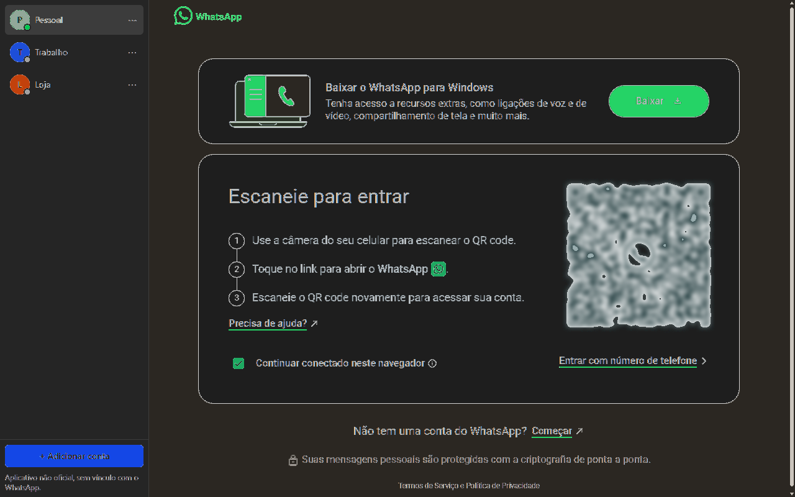

# WhatsApp Multi

[Português (Brasil)](#português-brasil) · [English](#english)

> **Aplicativo não oficial.** Sem vínculo, endosso ou patrocínio do WhatsApp ou da Meta. Ele apenas carrega o WhatsApp Web oficial (`web.whatsapp.com`).
> **Unofficial app.** Not affiliated with, endorsed by or sponsored by WhatsApp or Meta. It only loads the official WhatsApp Web (`web.whatsapp.com`).

---

## Português (Brasil)

Use várias contas do WhatsApp em uma única janela no Windows. Cada conta roda em uma sessão isolada, com login próprio.

### Download

Baixe o instalador **WhatsApp Multi 0.1.0** em [Releases](../../releases/latest) (`WhatsApp-Multi-Setup-0.1.0.exe`) e execute.

---

## English

Run multiple WhatsApp accounts in a single window on Windows. Each account runs in an isolated session with its own login.

### Download

Get the **WhatsApp Multi 0.1.0** installer from [Releases](../../releases/latest) (`WhatsApp-Multi-Setup-0.1.0.exe`) and run it.

---

### Imagens / Images

| Post (claro / light) | Post (escuro / dark) |
| --- | --- |
|  |  |

Ícone / Icon: [`docs/images/icon.ico`](docs/images/icon.ico) · [`docs/images/icon.png`](docs/images/icon.png)
